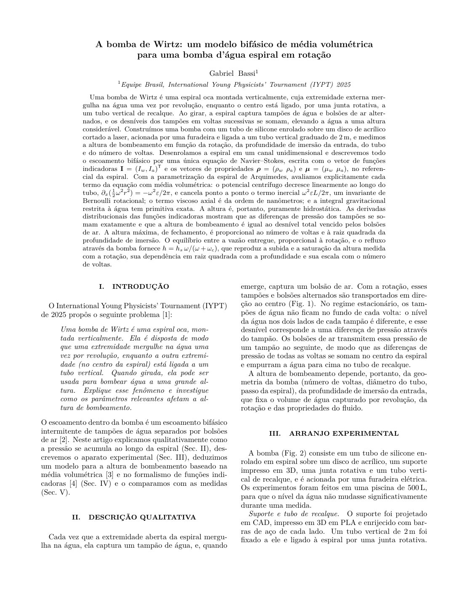
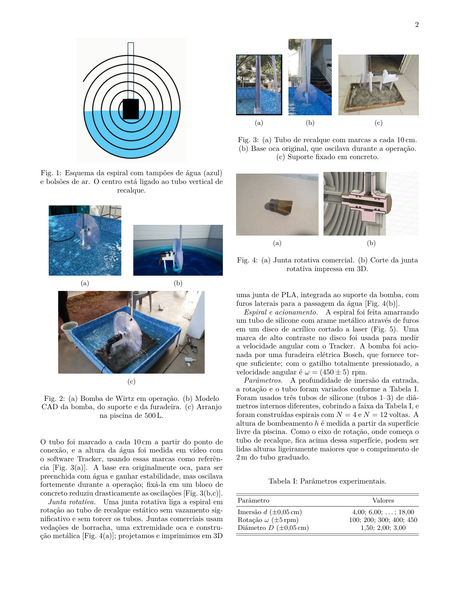
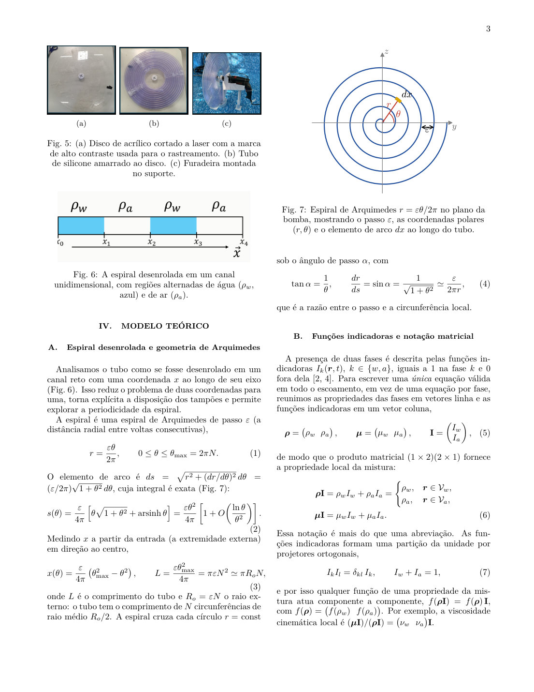
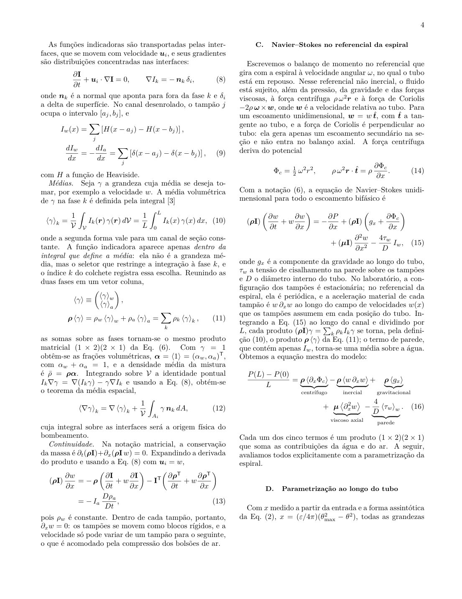
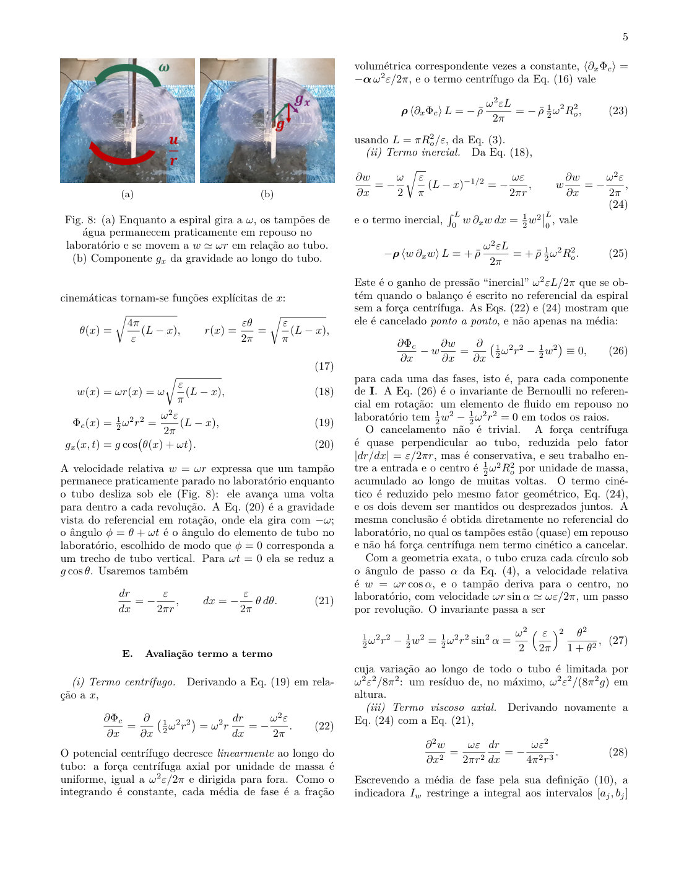
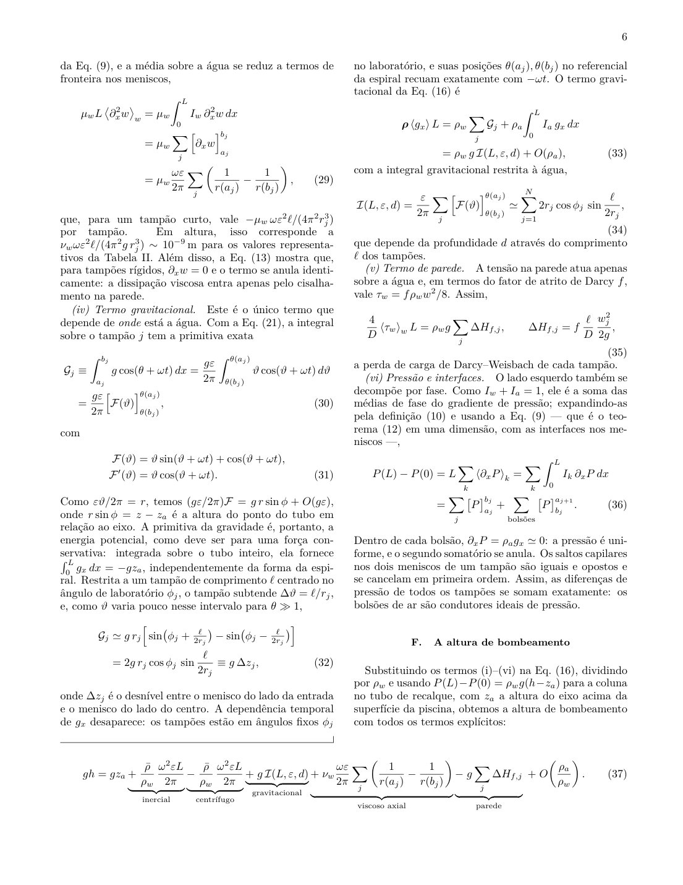
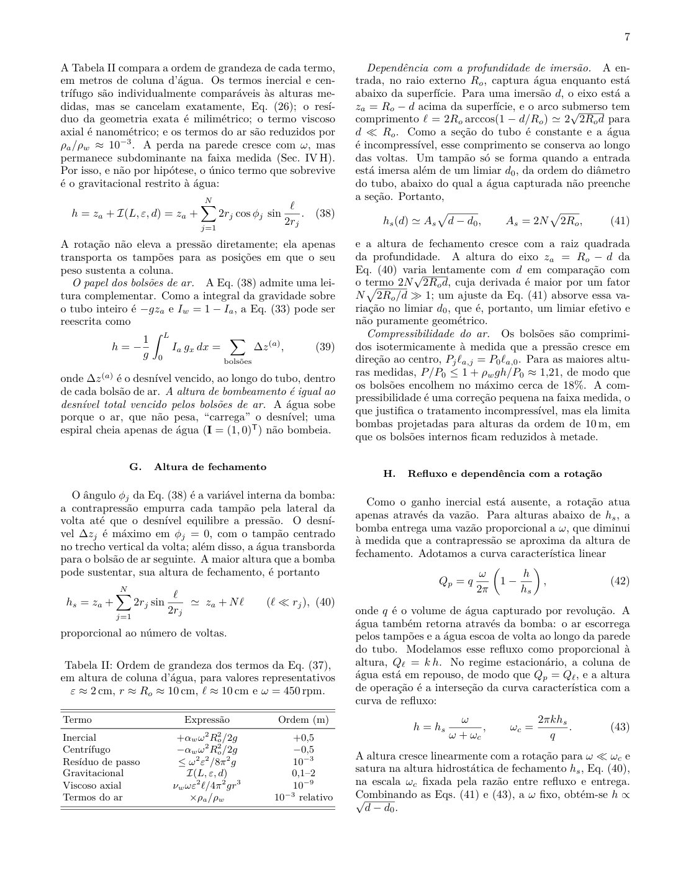
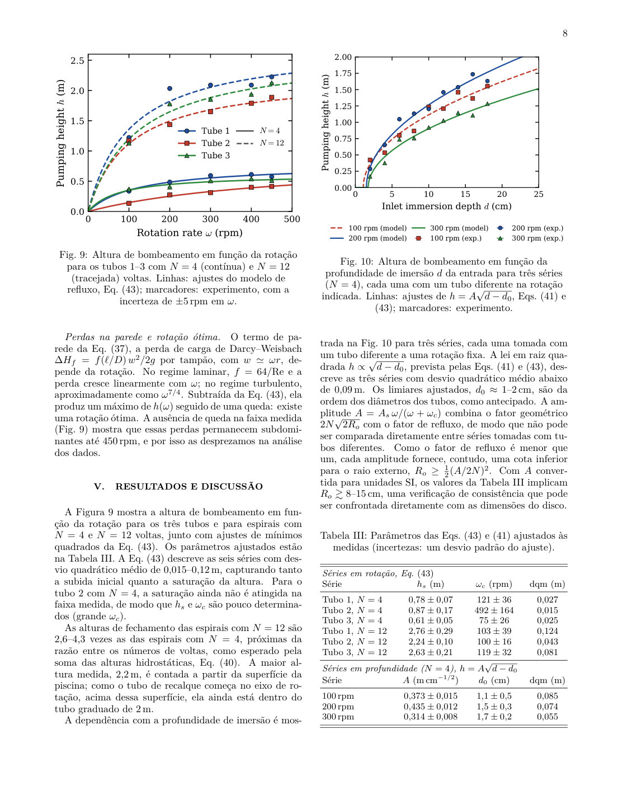
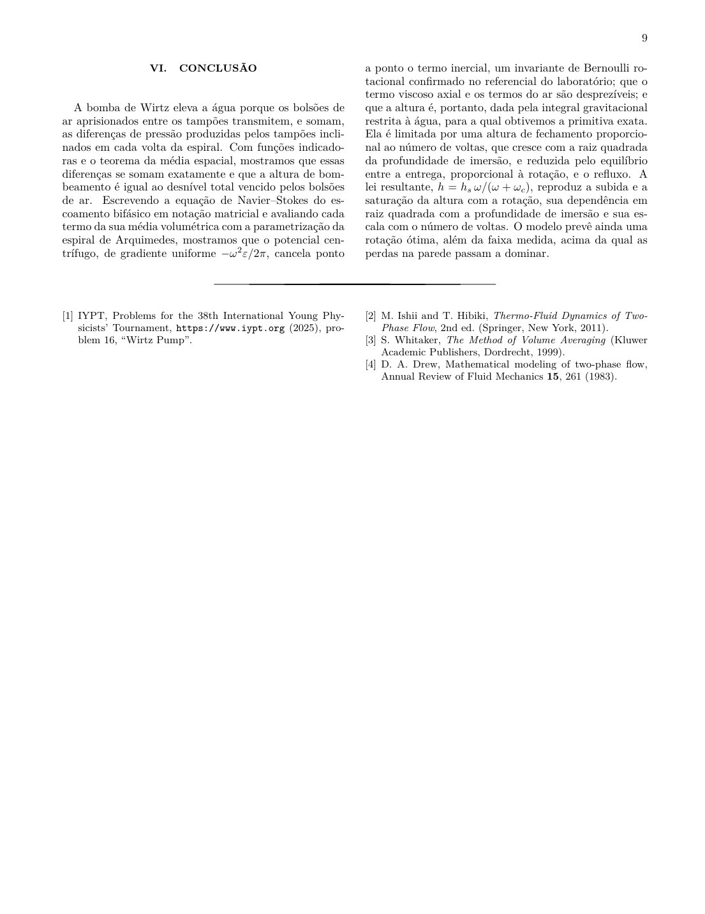

# A bomba de Wirtz

**Um modelo bifásico de média volumétrica para uma bomba d'água espiral em rotação**

Gabriel Bassi — Equipe Brasil, International Young Physicists' Tournament (IYPT) 2025, Problema 16 ("Wirtz Pump").

**[Ler o artigo online](https://gabrielbassidebm.github.io/bomba-de-wirtz-escoamento-bifasico/)** · [Abrir o PDF](main.pdf) · [Baixar o PDF](https://github.com/GabrielBassiDeBM/bomba-de-wirtz-escoamento-bifasico/raw/main/main.pdf)

## Resumo

Uma bomba de Wirtz é uma espiral oca que captura tampões de água e bolsões de ar alternados e eleva a água por um tubo vertical. Todo o escoamento bifásico é descrito por uma única equação de Navier–Stokes, escrita com o vetor de funções indicadoras e os vetores de propriedades das fases,

$$
\boldsymbol\rho = \begin{pmatrix}\rho_w & \rho_a\end{pmatrix},\qquad
\mathbf I = \begin{pmatrix} I_w\\ I_a\end{pmatrix},\qquad
\boldsymbol\rho\mathbf I = \rho_wI_w + \rho_aI_a ,
$$

no referencial da espiral. A média de fase de uma grandeza $\gamma$ é

$$
\langle\gamma\rangle_k = \frac{1}{\mathcal V}\int_{\mathcal V} I_k\,\gamma\,d\mathcal V ,
$$

e a equação mestra do modelo é

$$
\frac{P(L)-P(0)}{L}
= \boldsymbol\rho\langle\partial_x\Phi_c\rangle
- \boldsymbol\rho\langle w\,\partial_xw\rangle
+ \boldsymbol\rho\langle g_x\rangle
+ \boldsymbol\mu\langle\partial_x^2w\rangle
- \frac{4}{D}\langle\tau_w\rangle_w .
$$

Com a parametrização da espiral de Arquimedes, cada termo é avaliado explicitamente. O potencial centrífugo decresce linearmente ao longo do tubo e cancela ponto a ponto o termo inercial (um invariante de Bernoulli rotacional):

$$
\frac{\partial}{\partial x}\left(\tfrac12\omega^2r^2\right) = -\frac{\omega^2\varepsilon}{2\pi} = w\frac{\partial w}{\partial x}.
$$

O termo viscoso axial é da ordem de nanômetros, e a altura de bombeamento é dada pela integral gravitacional restrita à água:

$$
h = z_a + \mathcal I(L,\varepsilon,d) = z_a + \sum_{j=1}^{N}2r_j\cos\phi_j\,\sin\frac{\ell}{2r_j}.
$$

Equivalentemente, a altura de bombeamento é igual ao desnível total vencido pelos bolsões de ar. O equilíbrio entre entrega e refluxo fornece

$$
h = h_s\,\frac{\omega}{\omega+\omega_c},\qquad h_s(d) \simeq A_s\sqrt{d-d_0},
$$

que reproduz as medidas em função da rotação, da profundidade de imersão e do número de voltas.

## O artigo

O artigo completo, página a página. Para ler com zoom ou baixar, use os links no topo.











## Arquivos

- `main.tex`: fonte LaTeX (REVTeX 4.2, português)
- `references.bib`: referências
- `figures/`: figuras
- `main.pdf`: artigo compilado
- `paginas/`: páginas do artigo em imagem
- `index.html`: página de leitura (GitHub Pages)

## Compilação

Compile com pdfLaTeX + BibTeX (por exemplo, no Overleaf, enviando o repositório como projeto) ou localmente:

```
pdflatex main && bibtex main && pdflatex main && pdflatex main
```
